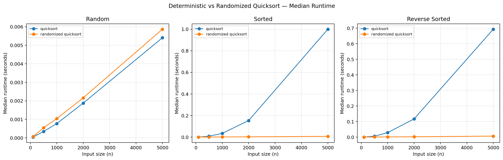

# Assignment 5: Quicksort Algorithm
*University of the Cumberlands*
*Algorithms and Data Structures*
## 1. Introduction
Quicksort is a comparison-sort algorithm that sorts an array by selecting a pivot, and moving elements smaller than the pivot to one side and elements greater than the pivot to the other. The result is that the two areas are then sorted. This submission will include a random version, and a deterministic version in python, a comparison of the theoretical costs of these two versions, and a comparison with measured runtime (for varying input sizes and for varying distributions of the input).
## 2. Implementation and design choices
The code implementing these is in quicksort.py. In-place sort a mutable sequence; for convenience, return it. Partition algorithm is taken from Lomuto partition scheme. Deterministic Quicksort is the version of the Quicksort algorithm that uses the last element in the current subarray as pivot. Randomized Quicksort: A random index from the whole active subarray is selected and exchanged with the final index of the subarray before the partition is implemented in the same manner as Quicksort.
Both versions use a loop for the bigger of the two partitions, and a recursive call for the smaller, so as to circumvent the recursion-depth limit in Python. This optimization maintains the partition sequence and the asymptotical behaviour in the running-time, but it bounds the use of stack. All empty sequences, inputs with only one element, repetition of elements and negative and/or positive comparable items are supported in the implementation (Shorman et al., 2024). The amount of randomness can be controlled by passing a seeded random. Random instance, which makes it possible to do repeatable correctness tests/experiments.
## 3. Time complexity analysis
Suppose that there are n elements. It takes Θ(m) time to partition a subarray of size m since each element is scanned only once.
### Best case
If every pivot is able to partition the current subarray into two subarrays of size about n/2, then the recurrence is T(n) = 2T(n/2) + Θ(n). There are Θ(log n) recursions, each of which does Θ(n) partition work. Thus, the best case time is Θ(n log n).
### Average / expected case
If we partition the elements properly, on average, we get the same divide and conquer argument with the bound Θ(n log n). Randomized Quicksort: No matter how the elements are initially sorted, all elements in the list have an equal chance of being chosen as pivot. The number of comparisons made should be Θ(n log n). Randomization will not necessarily result in an equal number of elements on each partition, but it will provide a reasonable chance that it does not experience a series of bad pivots.
### Worst case
Partitions will be of size 0 and n−1 if smallest or largest value is at each pivot. The recurrence is T(n) = T(n−1) + Θ(n), then the total work is Θ(n²). This occurs with sorted distinct inputs and reverse sorted distinct inputs with a deterministic pivot that is the last element. Although randomized Quicksort makes a random choice of pivot each time, if the same pivots are chosen repeatedly, and the pivots are extremely unbalanced, then the running time may be as large as Θ(n2).
| Case | Partition pattern | Time complexity |
| --- | --- | --- |
| Best | Balanced splits | Θ(n log n) |
| Average / expected | Splits balanced in aggregate | Θ(n log n) |
| Worst | One empty side and one side of size n−1 repeatedly | Θ(n²) |

## 4. Space complexity and overhead
No second array proportional to n is needed as the array is sorted in place. Partitioning is of auxiliary Θ(1). How much space is occupied in the stack depends again on the implementation: e.g. a recursive Quicksort needs only Θ(log(n)) in the best case and Θ(n) in the worst case. This submission makes the recursion depth of Python in the case of quadratic work of the partitions bounded by O(log n), even for the smaller side of the recursion. There is also a low pivot selection and random number generation overhead in Randomized Quicksort. Timing numbers include pivot selection, partitioning, recursion/loop controlling and Python interpreter overhead.
## 5. Empirical method
Benchmark compares the performance of both of them for the following data sets of integers: random, ascending sorted, and descending reverse sorted. Input sizes are 100, 500, 1,000, 2,000, and 5,000. The results of each algorithm/size/distribution combination are repeated 3 times; the median result displayed to dampen the impact of “noise” due to scheduling. It is possible to make the input generation and the randomized pivot choices reproducible, by fixing the seed. No timed outputs are accepted if incorrect compared to Python's sorted() output. Times listed are wall-times based off of the time.perf counter() call on the machine that ran the execution environment that produced this submission; this time does not necessarily reflect wall-times which will be experienced on other machines.
## 6. Empirical results

| n | Distribution | Deterministic median (s) | Randomized median (s) |
| --- | --- | --- | --- |
| 100 | random | 0.000043 | 0.000069 |
| 100 | sorted | 0.000259 | 0.000058 |
| 100 | reverse-sorted | 0.000205 | 0.000056 |
| 500 | random | 0.000342 | 0.000542 |
| 500 | sorted | 0.008076 | 0.000419 |
| 500 | reverse-sorted | 0.005617 | 0.000470 |
| 1000 | random | 0.000770 | 0.001040 |
| 1000 | sorted | 0.034127 | 0.000997 |
| 1000 | reverse-sorted | 0.028763 | 0.000997 |
| 2000 | random | 0.001876 | 0.002161 |
| 2000 | sorted | 0.153090 | 0.002422 |
| 2000 | reverse-sorted | 0.116629 | 0.002156 |
| 5000 | random | 0.005407 | 0.005867 |
| 5000 | sorted | 0.999676 | 0.006783 |
| 5000 | reverse-sorted | 0.693240 | 0.006377 |

*Figure 1: Median runtime comparison across input distributions.*
### Interpretation
At n=5000 on random input, deterministic median was 0.005407s and randomized median was 0.005867s.
At n=5000 on sorted input, deterministic median was 0.999676s and randomized median was 0.006783s.
At n=5000 on reverse-sorted input, deterministic median was 0.693240s and randomized median was 0.006377s.
The deterministic algorithm should be especially slow on a sorted and reverse-sorted input because it always selects the same pivot and in the best-case scenario, it always partitions into 0 and n – 1. Randomized pivot selection will cease to be dependent on the pivots given as input — this should give it a performance closer to what it would be expected to get with these distributions. A deterministic version can also be as competitive since a pivot at a fixed location in an array of items that is randomly ordered is not systematically extreme, and a randomized selection of pivot has a small selection cost (Wassenberg et al., 2022). On small measurements, the measurement may be quite sensitive towards the impact of interpreter noise as well as system noise, and then it becomes indicative of the trends between the sizes and distributions rather than the very small variation that may happen at a single size.
## 7. Correctness and limitations
Empty input and correctness are checked by the built-in Python sorted output, single element, duplicate and ordinary input are also tested by smoke tests. It is more like a real mathematics than a formal mathematics. The worst-case running time of both algorithms is quadratic, and, although the chance of being in the worst case can be lowered with randomization, it cannot be eliminated. The Benchmark timing is machine, Python version and system load dependent.
## 8. Conclusion
A trade-off in picking a pivot for Quicksort is shown in the experiment. The deterministic final-element pivot works easily and quickly on many inputs but it is sensitive to ordered data. Randomized pivot selection helps to make pivot quality independent of the order of the input, in expectation. Both implementations are in-place and have expected/average Θ(n log n) time and Θ(n²) worst-case time. They can use the benchmark CSV and plot to compare their behaviour to.
References
Shorman, A., Rateb, R., Alshorman, A., & Abu Shqair, S. (2024). Performance analysis of Quicksort algorithm: An experimental study of its variants. International Journal of Intelligent Systems and Applications in Engineering, 12(4), 4008–. https://www.ijisae.org/index.php/IJISAE/article/view/6966
Wassenberg, J., Blacher, M., Giesen, J., & Sanders, P. (2022). Vectorized and performance-portable quicksort. Software: Practice and Experience, 52(12), 2684–2699. https://doi.org/10.1002/spe.3142
